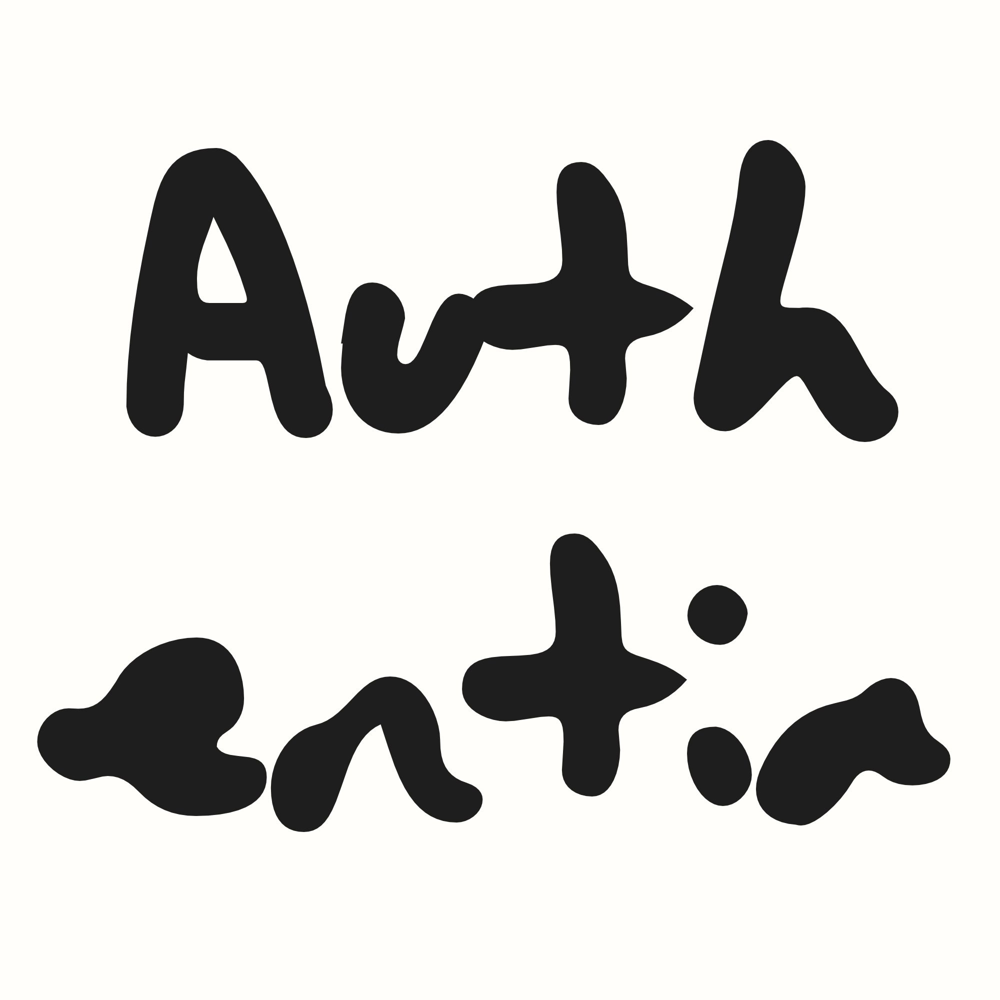

<p align="center">
  
</p>

# Authentia

A browser extension for time-based one-time passwords (TOTP), the codes your
services ask for after a password. Accounts live in a vault in the browser's
local storage. The toolbar popup shows every account with a live code and copies
a code when you click it. The settings tab holds the passcode, the encrypted
backup and the data reset.

The code runs on your machine. Accounts stay in the browser's local storage and
never leave it.

Current version: 0.2.1. Chromium browsers (Chrome, Edge, Brave) and Firefox.

## What it does

- Shows live 6- or 8-digit codes for every saved account, with a countdown rule
  that shows the current step draining.
- Adds an account from a base32 secret, an `otpauth://totp/...` setup link, or a
  QR code visible on the page you are looking at.
- Copies a code when you click its row and confirms with a "Copied" chip.
- Filters by issuer or account name once you have more than five accounts. Press
  `/` to jump to the search field.
- Optionally encrypts the vault with a 6-digit passcode. Without a passcode the
  vault is plaintext on disk, and the UI says so.
- Exports an encrypted JSON backup and restores it later, either merged into the
  current accounts or replacing them.
- Keeps everything local. The screen scanner decodes the pixels in the extension
  and never uploads the capture.

## Install

The extension is not in a browser store yet, so you build it from source.

You need Node.js 22 or newer and npm. The repository pins the package manager to
`npm@11.19.0`.

```bash
git clone https://github.com/denyryn/authentia.git
cd authentia
npm ci
npm run build:chrome
```

This writes an unpacked extension to `dist/chrome` and a zip to `dist/`.

### Chrome, Edge, Brave

1. Open `chrome://extensions` (or `edge://extensions`).
2. Turn on Developer mode.
3. Choose **Load unpacked** and select `dist/chrome`.
4. Pin Authentia to the toolbar.

### Firefox

```bash
npm run build:firefox
```

1. Open `about:debugging#/runtime/this-firefox`.
2. Choose **Load Temporary Add-on**.
3. Select `dist/firefox/manifest.json`.

A temporary add-on disappears when Firefox restarts. Loading it permanently
needs a signed build, which is not published.

The Firefox build is Manifest V2. Chromium builds are Manifest V3.

## Use

### Add an account

Open the popup and click **+**. The setup field accepts either:

- an `otpauth://totp/Issuer:account?secret=...` link, or
- the base32 setup key a service shows next to its QR code.

A pasted link fills the issuer, account, algorithm, digit count and period after
a short debounce. A bare key uses SHA1, 6 digits and a 30-second period. The
form previews a live code before you save, so a bad secret or a bad link fails
before it reaches the vault.

If the same issuer and account name are already saved, the form asks before
overwriting.

### Scan a QR code from the page

Click the scan button in the popup header, then drag a box around a QR code on
the page. The page dims, the extension reads the framed area, and the decoded
link lands in the add form the next time the popup opens.

The scan runs only on the tab in front of you and only after you draw the box.
The capture is cropped, decoded locally with `jsQR`, and discarded.

Pages the browser protects, such as the new tab page, the extension gallery and
browser settings, cannot be scripted. The popup reports that inline. Manual
entry remains the fallback.

### Copy, search, edit

Click a row to copy its code. The identity line turns into a "Copied" chip for a
moment; a blocked clipboard request reports the failure in the same place.

Search appears after the sixth account. It matches issuer and account name.
Press `/` anywhere in the popup to focus it.

The pencil at the right of a row opens the edit form. On touch screens it is
always visible; on pointer devices it appears on hover or keyboard focus. Delete
lives at the bottom of the edit form and asks for confirmation.

### Passcode and auto-lock

Settings, **Passcode**, lets you set a six-digit code. Setting one derives a key
with PBKDF2-SHA256 and rewrites the vault as AES-GCM ciphertext. The next time
the popup opens, or the options page loads, the vault is locked until you enter
the code.

The auto-lock selector offers 5, 15, 30 or 60 minutes. The default is 15.
Unlocking stores the derived key with an expiry, and every write extends it.
The vault locks when that expiry passes. Where the browser provides session
storage, the key also dies on browser restart. A browser without one falls back
to local storage and still enforces the stored expiry.

Five wrong attempts pause entry for 30 seconds; ten pause it for five minutes.
The counter lives in settings. This is a speed bump against someone tapping at
your keyboard, not a defense against an attacker who has your browser profile.

Changing the passcode decrypts with the old code and re-encrypts with a fresh
salt and key. Removing it rewrites the vault as plaintext after a warning.

### Backup and restore

Settings, **Backup**, creates an encrypted JSON file. Use at least eight
characters for the backup passphrase and type it twice. The passphrase can differ
from the unlock passcode, so a forgotten passcode does not also lock you out of
the backup.

The finished backup can be copied or downloaded as
`authentia-backup-YYYYMMDD.json`. Anyone with the file and the passphrase can read
every secret in it.

Restore accepts an uploaded file or pasted text plus the backup's passphrase.
Two modes:

- **Merge** keeps current accounts and matches incoming ones by issuer and account
  name, case-insensitively. Identical entries are skipped; changed secrets
  update the existing row. The result reports added, updated and skipped counts.
- **Replace all** deletes the current accounts and keeps only the backup's.

### Delete everything

Settings, **Danger zone**, removes the vault, its settings and the session key.
The confirmation asks you to type `delete`. A backup kept elsewhere is the only
thing that survives.

## Privacy and security

Stored by the extension:

- `vault`, local: either `{version: 1, encrypted: false, items: [...]}` or an
  envelope with KDF parameters, a salt, a 12-byte IV and base64 ciphertext.
- `settings`, local: auto-lock minutes, failed-attempt counter, lockout deadline.
- `scan.link`, local: a decoded setup link waiting for the popup, removed when
  read.
- `session`, session storage where available: the raw AES key and its expiry.

Encryption details:

- PBKDF2-SHA256, 600,000 iterations, 16-byte random salt created per passcode.
- AES-GCM-256, a fresh 12-byte IV on every write.
- Additional authenticated data binds the vault format (`authentia:vault:v1`) and
  the backup format (`authentia:backup:v1`).
- A successful decrypt is the passcode check. There is no separate verifier value
  and no "wrong passcode or damaged vault?" ambiguity.

What the passcode can and cannot do:

- A six-digit passcode has 10^6 possible values. With the vault file in hand, an
  offline attacker can search that space on a decent GPU in hours even at 600,000
  PBKDF2 iterations. The passcode stops casual access to your browser session.
  It does not stop a determined attacker with your profile directory.
- There is no passcode recovery. A backup with its own passphrase is the way back
  in.
- Without a passcode the vault is plaintext. The popup footer states where the
  vault lives, and the settings page offers to encrypt it.
- Lockout state is stored next to the vault. Clearing extension storage clears
  it.

Clipboard:

- A code is written only after a click, so the extension does not request the
  `clipboardWrite` permission.
- There is no clipboard auto-clear timer. A timer would die when the popup closes.

Network and capture:

- The shipped code makes no network requests. The manifest lists host permissions
  for `one.one.one.one` and `worldtimeapi.org` for a clock-sync feature that is not
  implemented yet. They are unused today; see [Known limits](#known-limits).
- Screen scanning uses `activeTab`, granted by your click, plus `scripting`. The
  capture happens after the selection box is drawn, is cropped before decoding,
  is never written to disk, and is never sent anywhere.
- There is no telemetry, crash reporting or remote configuration.

Clock accuracy:

Codes are computed from the device clock. If a service rejects codes that another
authenticator accepts, check the system clock, especially after sleep, travel or
a long shutdown. A built-in time sync is planned but not built.

## Development

```bash
npm ci
npm run dev
```

`npm run dev` starts Extension.js with a development build and opens a browser
with the extension loaded. Profiles are kept under `dist/extension-profile-*` as
configured in `extension.config.js`; delete those directories for a clean
profile.

### Scripts

| Command | What it does |
| --- | --- |
| `npm run dev` | Extension.js development mode, default browser |
| `npm run start` | Extension.js start with an existing development build |
| `npm run build` | Chromium build plus zip |
| `npm run build:chrome` | Chrome build plus zip |
| `npm run build:firefox` | Firefox build plus zip |
| `npm run build:edge` | Edge build, no zip |
| `npm run preview` | Preview a production build in a browser |
| `npm run preview:ui` | Vite harness for the popup and options UI, seeded with memory data |
| `npm test` | Vitest suite, one run |
| `npm run typecheck` | `tsc --noEmit` |

`preview:ui` mounts the real pages with `createMemoryEnv()`, so UI work does not
need an extension reload. It does not exercise browser APIs, the background
worker or the scanner.

### Build output

`npm run build:chrome` and `npm run build:firefox` produce `dist/chrome` and
`dist/firefox`, plus zips named `authentia-<version>-<browser>.zip` in `dist/`.
The manifest is generated from `src/manifest.json`, which keeps both browser
variants through `chromium:` and `firefox:` prefixes.

### Release

Pushing a tag `v*` runs `.github/workflows/release.yml` on Node 22. The workflow
checks that the tag matches `package.json`, runs typecheck and tests, builds
Chrome and Firefox, and publishes both zips as a GitHub release.

The tag must equal the package version, for example `v0.2.1` for version `0.2.1`.
Release notes come from the matching section of `CHANGELOG.md`.

## Project layout

```
src/
  action/          popup entry, PopupApp
  options/         settings entry, OptionsApp, sections, form fields
  components/      account list, row, form, passcode gate, input, ui primitives
  hooks/           use-vault, use-now
  lib/             base32, totp, otpauth, crypto, vault, backup, scan, env
  styles/          tokens.css (the only literal design values), globals.css
  background.ts    scanner capture, crop, decode, link handoff
  manifest.json    Chromium MV3 and Firefox MV2 variants
docs/
  PRD.md           product requirements and design decisions
  PLAN.md          implementation plan; later features are ahead of the code
preview/           Vite preview harness with an in-memory environment
STORE.md           store listing metadata, with owner TODOs marked
```

### Architecture

**One environment seam.** Every page takes an `Env` object:

```ts
type Env = {
  local: Store
  session: Store
  now(): number
  fetch: typeof fetch
  copy(text: string): Promise<void>
  openOptions(): void
  startScan(): Promise<{ok: true} | {ok: false; reason: string}>
  takeScannedLink(): Promise<string | undefined>
}
```

`src/lib/chrome-env.ts` implements it with `chrome`/`browser` APIs. Tests use
`src/lib/memory-env.ts`, and `preview/` reuses the same fake. Page and component
files do not import the extension API directly. This is what lets the real UI run
in Vitest without mocking crypto or timers.

**Vault lifecycle.** `loadVault()` returns `empty`, `locked`, or `open` with a
plaintext or encrypted mode. An encrypted vault is readable only when a valid,
unexpired session key exists. Writes take an open vault, re-encrypt under the same
key with a fresh IV, and slide the expiry forward. `saveItems()` on a new install
creates the first plaintext document so an account can be saved before a passcode
is set. Removing the passcode rewrites plaintext and deletes the session key.

**Scan pipeline.** `startScan()` injects `scanOverlay` into the active tab as a
function (MV3 `scripting.executeScript`) or source text (MV2
`tabs.executeScript`). The overlay draws a shadow-DOM selection layer and hides
itself before asking the background to read the box. The background calls
`tabs.captureVisibleTab`, maps the CSS-pixel box onto the captured device pixels,
crops with a canvas, decodes with `jsQR`, validates the result with
`parseOtpAuth`, and stores the link under `scan.link`. The popup collects it on
open. The background never reads the vault.

**TOTP engine.** `base32.ts` decodes RFC 4648 input and tolerates lowercase,
spaces and missing padding. `totp.ts` builds the 8-byte big-endian counter, signs
with WebCrypto HMAC, applies dynamic truncation and zero-pads to the requested
digit count. `otpauth.ts` accepts SHA1, SHA256 and SHA512, 6 or 8 digits, and
periods from 15 to 120 seconds. Google Authenticator's
`otpauth-migration://` export is rejected with a specific message instead of being
misparsed.

**Backup format.** `backup.ts` wraps the account array in its own KDF block,
IV and ciphertext, tagged `kind: "authentia-backup"`. Restore derives a key from
the file's own parameters. Merge identity is issuer plus account name, so
importing another machine's backup updates rows instead of duplicating them;
matching ids would fail because ids are generated per install.

**UI system.** All visual values come from `src/styles/tokens.css`. Components
consume tokens by name, and `globals.css` maps them to Tailwind utilities. The
palette is warm paper and ink with one highlighter accent used in three places:
the copied chip, the focused passcode box and the last five seconds of the
countdown. The theme is light only. `button` and `dialog` are the only UI
primitives; the dialog wraps the native `<dialog>` element and `showModal()`.
Mutually exclusive choices use segmented tabs, not radio buttons.

## Testing

The suite uses Vitest with jsdom and React Testing Library. Crypto runs for real
on Node's WebCrypto; time is passed in explicitly rather than faked globally.

Covered:

- Base32 tolerance and rejection tables.
- RFC 6238 vectors for SHA1, SHA256 and SHA512, 6 and 8 digits, 30- and 60-second
  periods, and step boundaries.
- `otpauth` parsing, defaults and rejection, including migration URIs.
- Encrypt/decrypt round trip, wrong passcode, fresh IV per write, tampered
  ciphertext, passcode change and removal.
- Backup export and import with a different passphrase, merge de-duplication and
  the added/updated/skipped report.
- CSS-to-device-pixel crop math at 1x and 2x, clamping and the zero-size guard.
- The account form through the environment seam: seeded link, debounce, preview.
- The passcode input keyboard behavior.
- Vault storage behavior and locked/unlocked state transitions.

The QR decode path (capture, crop, jsQR) is not covered by the jsdom tests.
Check it by hand in a browser with a generated code.

Run before calling a change done:

```bash
npm run typecheck
npm test
npm run build:chrome
```

Add `npm run build:firefox` when the manifest, background worker or scan path
changes.

## Contributing

1. Keep the environment seam intact. New browser behavior belongs in `Env` and
   `chrome-env.ts`; pages receive it as a prop.
2. Put user-visible behavior under test. A test should fail if the UI shows a
   wrong digit, loses a saved account, or reports success after a failed write.
   Tests assert what a user can observe, not private call order or internal state.
3. Use design tokens. Do not add literal colors, font sizes, radii, spacing values
   or animation durations to components. If a token is missing, add it to
   `tokens.css`.
4. Keep the theme light. The token file has a scoped, inert dark variant; do not
   apply `.dark` or write `dark:` utilities.
5. Write user-facing copy in sentence case, without emoji and without promising
   synchronization accuracy or passcode strength the code cannot deliver.
6. Preserve the two browser variants. Manifest edits use the `chromium:` and
   `firefox:` prefixes; run both builds.
7. Use the commit convention already in the history: `feat: ...`, `fix: ...`,
   `docs: ...`.

Small changes can go straight to a pull request. For a new feature, open an issue
that states the user-visible behavior and the storage or permission changes it
needs.

## Known limits

- **No clock sync.** Codes rely on the system clock. The manifest reserves time
  host permissions; nothing uses them yet. Remove them or ship the feature before
  a store submission.
- **Store submission is not prepared.** `STORE.md` still contains owner TODOs for
  screenshots, support email, homepage and category.
- **Screen scanning only.** There is no camera capture and no image-file import.
- **No Google Authenticator migration.** `otpauth-migration://` links are rejected;
  accounts must be exported or entered one at a time.
- **No cloud or device sync.** Accounts exist in one browser profile. Backups move
  them by hand.
- **Six-digit passcode only.** A longer passphrase is the obvious next step for
  the offline-guessing risk described above.
- **No clipboard auto-clear.** Copying leaves the code in the clipboard.
- **Light theme only.**
- **Firefox is Manifest V2.** Where session storage is unavailable, the unlock key
  falls back to local storage, bounded by its `expiresAt` value.
- **No Safari, no localization, no telemetry.**

## Troubleshooting

**A service rejects every code.** Check the system clock, including the time zone
and seconds, then reload the popup. There is no built-in sync yet.

**The code differs from another authenticator.** Check the secret, algorithm,
digits and period in the edit form. The same account with a different period or
algorithm produces different digits.

**Scanning says the page cannot be scanned.** Browser-internal pages, extension
galleries and some browser UIs refuse script injection. Open the site's normal
page and scan there, or paste the setup link into the add form.

**The frame has no QR code.** The box must contain the code with a quiet border
around it. Drag tighter, avoid glare, and try again. The overlay stays open with
the message.

**I forgot the passcode.** The vault cannot be decrypted without it. If you made a
backup, open Settings, erase the vault from the locked view, then restore the
backup with its own passphrase. Without a backup the accounts are gone.

**The popup closes while scanning.** That is expected. The decoded link is saved
and appears in the add form next time the popup opens.

## Documentation

- `docs/PRD.md`: product requirements, data model, crypto decisions, threat model.
- `docs/PLAN.md`: implementation plan. It describes clock sync and other features
  that are not in the code yet; treat it as a plan, not a description.
- `CHANGELOG.md`: release history.
- `STORE.md`: listing metadata and submission TODOs.

## License

MIT, as declared in `package.json`.
